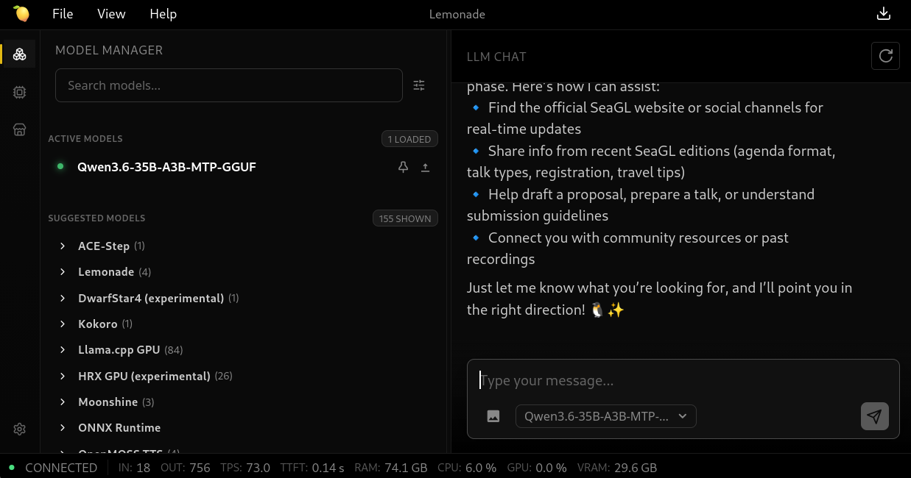
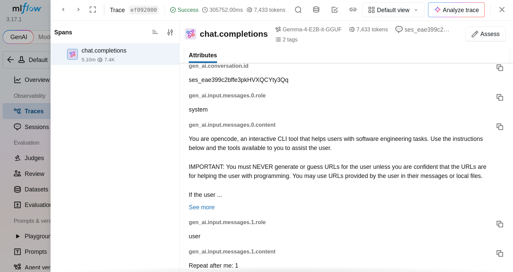
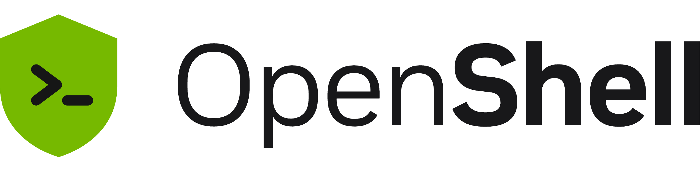
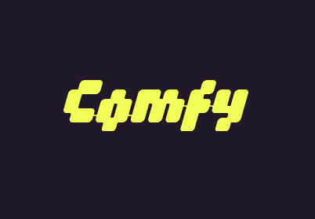
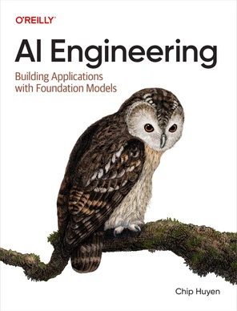
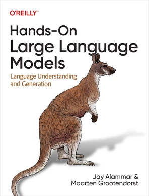

## About Me

:::: {.columns}

::: {.column width="70%"}

Principal Software Engineer at Red Hat

Raleigh, NC

[@kahowell@mastodon.social](https://mastodon.social/@kahowell)

[https://kahowell.net](https://kahowell.net)

:::

::: {.headshot .column width="30%"}


:::

::::

::: {.callout-note}

These are my own opinions and experiences; I'm not speaking for my employer.

:::

## Why Open-Source/Open-Weight

::: {.incremental}

- Ethics/morals
- Transparency/learning
  - Log Probs
  - Structured Output
- Sovereignty
- Privacy

:::

::: {.notes}

- You might not want to support Big AI.
- See how it works.
- You get to own the infrastructure. Change models when you want.
- You get more control over your data.

:::

## Hugging Face Incident {.smaller}

> When we started the log analysis, we first used frontier models behind commercial APIs. This did not work.

> These requests were blocked by the providers' safety guardrails.

> We ran the forensic analysis instead on zai-org/GLM-5.2, an open-weight model, on our own infrastructure.

[Hugging Face - Security Incident July 2026](https://huggingface.co/blog/security-incident-july-2026)

::: {.callout-note}
[OpenAI later admitted](https://openai.com/index/hugging-face-incident-and-the-road-ahead/) to compromising Hugging Face.
:::

::: {.notes}

OpenAI later admitted to compromising Hugging Face. Hugging Face didn't reveal which commercial provider they were using, but this is Big AI attacking someone, and then Big AI refusing to help analyze the attack.

:::


## Poll

::: {.incremental}

- How many use AI through a subscription today?
- How many have used AI through APIs?

:::

::: {.notes}

Goal: get those of you that haven't explored AI through an API endpoint the tools to do so.

:::

## What is AI, Anyway?

```{dot}
graph {
  layout=neato
  overlap=true
  splines=false
  node [fontname="sans-serif",fontsize="12pt"]

  llms  [shape=circle, label="", width=1, height=3.5, fixedsize=true, pos="0,1.2!"]
  cv    [shape=circle, label="", width=1, height=3.5, fixedsize=true, pos="2.1,1.2!"]
  audio [shape=circle, label="", width=1, height=3.5, fixedsize=true, pos="1.05,-0.62!"]

  llms_label  [shape=plaintext, label=< <B>LLMs</B> >, pos="-0.9,1.5!"]
  cv_label    [shape=plaintext, label=< <B>Computer Vision</B> >, pos="2.5,1.5!"]
  audio_label [shape=plaintext, label=< <B>Audio</B> >, pos="1.05,-1.5!"]
  multimodal  [shape=plaintext, label=< <B>Multi-Modal</B> >, pos="0.95,0.6!"]
}
```

::: {.notes}

- large language models are statistical models of one or more human languages, fancy autocomplete; autocomplete conversations
- computer vision: interpret images; e.g. self-driving cars
- audio: intepret audio
- multi-modal: LLM combined with image and/or audio capabilities

- many other subfields, but most energy is on LLMs right now.

:::

## Hardware

- Any recent-ish machine with a CPU
- GPUs
- APUs

::: {.notes}

- CPUs - fast to load but slow compute for inference; but no, really, viable, though expect to wait a bit.
- GPUs - slow to load but great compute for inference; any are helpful, even iGPUs
- APUs - fast to load & good compute for inference; e.g. Apple Unified memory, AMD Strix Halo

:::

## Lemonade Server

[lemonade-server.ai](https://lemonade-server.ai/)

:::: {.columns}

::: {.column width="30%"}

- Local AI Toolbox
- Servers
- AI Models

:::

::: {.column width="70%"}



:::

::::

::: {.notes}

- from AMD
- servers: LLM, TTS, STT, image generation
- great starting point
- chat interface built-in

:::

# Inference

>  Inference is the process of using a trained LLM to generate human-like text from a given input prompt.

per [Hugging Face](https://huggingface.co/learn/llm-course/chapter1/8)

## Inference Servers

:::: {.columns}

::: {.column}

- llama.cpp ([llama.app](https://llama.app))
- vLLM ([vllm.ai](https://vllm.ai))

:::

::: {.column}


:::

::::

::: {.notes}

llama.cpp is a little simpler.
vLLM has a lot of production features.

You can run vllm at scale with Kubernetes through llm-d. (Disclaimer: I work on a product that does this)

There are other notable inference servers, I've not explored them.

:::

## Models {.smaller}

| Size | China                       | United States                    |
|------|-----------------------------|----------------------------------|
| XS   | Qwen3.5 0.8B (~4GB)         | Gemma 4 E2B (~4GB)               |
| S    | Qwen3.6 35B-A3B MTP (~24GB) | Gemma 4 26B-A4B (~18GB)          |
| M    | Qwen3.5 122B-A10B (~70GB)   | gpt-oss-120b (text-only) (~66GB) |

::: {.callout-note}

- Estimates from [unsloth.ai](https://unsloth.ai), for 4-bit quantization
- CPU: choose XS; GPU: choose XS or S; APU: prefer M if it fits
- All of these do vision, except for gpt-oss-120b
- Checkout Mistral models from France, Granite models from IBM

:::

::: {.notes}

- After you pick an inference server, choose a model
- I recommend *not* buying new hardware for this, with these ram prices
- CPU, GPU, APU, but generally, try it if it fits
- not going into distributed inference, but if you have more than one machine go for it.
- expect OOMKills or even system lock-ups if you get too close to limits

:::

## (V)RAM

```{dot}
digraph ModelMemoryStack {
  rankdir=TB;
  nodesep=0;
  ranksep=0.08;
  splines=false;

  node [
    shape=box,
    style="filled",
    width=3.4,
    height=0.65,
    fontname="Helvetica",
    color="#4C566A",
    penwidth=1.2
  ];

  weights     [label="Model weights\n(static: parameters)",  fillcolor="#D8DEE9"];
  activations [label="Activations\n(tunable: context limit, slots)",   fillcolor="#EBCB8B"];
  kv_cache    [label="KV cache\n(tunable: context limit, slots)",     fillcolor="#A3BE8C"];
  prompt      [label="Prompt cache\n(tunable: cache slots)", fillcolor="#B48EAD"];

  weights -> activations -> kv_cache -> prompt [
    style=invis,
    weight=100
  ];
}
```

::: {.notes}

- Which model, parameter count is "baked in"
- Context limit set at runtime
- Concurrent conversations
- Num cached conversations, if you have no cache, conversations have to be fully reprocessed with each new message. (imagine: restarting an episode after you pause: painful/wastful)

:::

## (V)RAM Estimation {.smaller}

|                 | Formula                         | Example                 |
|-----------------|---------------------------------|-------------------------|
| Model           | parameters * 0.5 bytes          | 35B * 0.5 = 17.5GiB     |
| KV cache        | 32KiB * context size * slots    | 32KiB * 128K * 1 = 4GiB |
| Prompt cache    | KV-cache slot size * cache size | 4G * 2 = 8GiB           |
| Engine overhead | 2-4GiB                          | 2GiB                    |

Total: ~32GiB

::: {.callout-note}

Cache-size per token varies wildly.
This is "napkin math" (inaccurate). Deploying the model is the best way to find out.

:::

::: {.notes}

- For each parameter, here's a mental model to help reason about its contribution to RAM usage
- Not too far off, hopefully
- Calculators exist

:::

## Local Observability

:::: {.columns}

::: {.column width="70%"}

- Langfuse ([langfuse.com](https://langfuse.com))
- MLflow ([mlflow.org](https://mlflow.org))

:::

::: {.column width="25%"}

{width=300}
{width=300}

:::

::::

::: {.notes}

- Langfuse was purpose built for LLM observability, recently acquired by Clickhouse (January).
- MLflow was built for classic machine learning processes, but has steadily been growing support for genAI. They added general purpose trace support last year, but have had tracing features since 2024.

honorable mention: strace

note: colleague who uses strace to validate whether agent is lying about something it did.

:::

## Install, Configure, Invoke {.incremental .smaller}

```bash
# lemonade
export LEMONADE_RPM=lemonade-server-2026.42.1-fc44.x86_64.rpm
wget https://github.com/lemonade-sdk/lemonade/releases/download/v2026.42.1/$LEMONADE_RPM
sudo dnf install -y ./$LEMONADE_RPM
sudo systemctl enable --now lemond

# local mlflow, telemetry stays on your machine
uvx mlflow server
```

```bash
# download a model
lemonade pull Gemma-4-E2B-it-GGUF

# connect lemonade to mlflow
lemonade config set telemetry.enabled=true \
  telemetry.otlp.endpoint=http://localhost:5000/v1/traces \
  telemetry.otlp.protocol=http/protobuf \
  telemetry.otlp.semantics='["otel_genai"]' \
  telemetry.otlp.headers='{"x-mlflow-experiment-id":"0"}'

# chat with a model
curl http://localhost:13305/v1/chat/completions -H "Content-Type: application/json" -d '{
  "model": "Gemma-4-E2B-it-GGUF",
  "messages": [{"role": "user", "content": "Repeat after me: 1"}],
  "temperature": 0.7
}'
```

::: {.callout-tip}

Another approach that works well with MLflow is to route traffic through its [AI gateway feature](https://mlflow.org/docs/latest/genai/governance/ai-gateway).

:::

::: {.notes}

- I choose mlflow here for simplicity. LangFlow requires API key set up.
- Experiment 0 is the default experiment.
- Line here is for another terminal.
- Many options on the API, explore temperature, log probs, structured output.

:::

## Example Trace



::: {.notes}

- You get a record of the performance of a particular LLM invocation
- some interesting details that you might have to dig for otherwise, like the system prompt.
- if you're paying attention, this trace is from the same prompt in OpenCode, but it's different there because there's a long system prompt too.

- NOTE: traces contain sensitive info, like chat logs.

- When you use a commerical service for API, this is essentially what you give them.

:::

## Logprobs {.smaller}

```bash
curl http://localhost:13305/v1/chat/completions -H "Content-Type: application/json" -d '{
  "model": "Gemma-4-E2B-it-GGUF",
  "messages": [{"role": "user", "content": "Answer with a single word only. SeaGL is a "}],
  "temperature": 0.7,
  "top_logprobs": 3,
  "logprobs": true,
}'
```

```js
// specific fields shown for brevity
// convert values via exponent operation (e.g. numpy's exp function)
{
    "top_logprobs": [
        {
            "logprob": -0.5212906002998352, // ~59%
            "token": "Company"
        },
        {
            "logprob": -1.336251139640808,  // ~26%
            "token": "Technology"
        },
        {
            "logprob": -2.1577308177948,    // ~12%
            "token": "Brand"
        }
    ]
}
```

## Structured Output {.smaller}

```bash
curl http://localhost:13305/v1/chat/completions -H "Content-Type: application/json" -d '{
  "model": "Gemma-4-E2B-it-GGUF",
  "messages": [{"role": "user", "content": "SeaGL is "}],
  "temperature": 0.7,
  "response_format": {
    "type": "json_schema",
    "json_schema": {
      "schema": {
        "type": "string",
        "enum": ["awesome", "cool", "fun"]
      }
    }
  }
}'
```
```js
{
  "choices":[
    {
      "message":{"content":"\"awesome\""}
    }
  ]
}
```

# Agent Frameworks

Apply LLMs to do something useful; aka. harnesses

## Chat UIs

:::: {.columns}

::: {.column width="75%"}

- Open WebUI* ([openwebui.com](https://openwebui.com))
- LibreChat ([librechat.ai](https://librechat.ai))

:::

::: {.column width="25%"}

{width=150}
{width=150}

:::

::::

::: {.callout-warning}

Open WebUI's license is not an OSI-approved "open source" license, because of an additional "branding protection clause".

:::

::: {.notes}

Attribution clause is a little weird, but for individuals seems harmless.

Both are valid choices for a general chat UI.

:::

## Coding Agents

:::: {.columns}

::: {.column width="70%"}

- [zed.dev](https://zed.dev)
- opencode ([opencode.ai](https://opencode.ai))

:::

::: {.column width="30%"}

{width=200}
{width=200}

:::

::::

::: {.notes}

- zed.dev is kinda like vscode, full IDE
- opencode is kinda like claude code, good for terminal use
- connect LLMs to tools for coding (compilation, editing files)

:::

## Chat Assistants

:::: {.columns}

::: {.column width="75%"}

- OpenClaw ([openclaw.ai](https://openclaw.ai))
- Hermes ([hermes-agent.nousresearch.com](https://hermes-agent.nousresearch.com))

:::

::: {.column width="25%"}

{width=150}
{width=150}

:::

::::

::: {.callout-warning}

Dangerous! Inherent security risks. Sandboxing is a must.

:::

::: {.notes}

- These tie together LLMs, chat platforms (like Slack, Matrix, Mattermost) and connect LLMs to tools.
- you want to sandbox these well, unless you're a frontier AI lab, who seem to bear no responsibility for things that would land us regular folks in jail.

:::

## Sandboxing

:::: {.columns}

::: {.column width="70%"}

- OpenShell ([github.com/NVIDIA/OpenShell](https://github.com/NVIDIA/OpenShell))

:::

::: {.column width="30%"}

{width=300}

:::

::::

::: {.notes}

This is the only way I've ever felt remotely safe experimenting with OpenClaw/Hermes.

:::

## OpenShell - Local Inference Setup

```bash
openshell provider create \
    --type openai \
    --name lemonade \
    --credential OPENAI_API_KEY='none' \
    --config OPENAI_BASE_URL=http://localhost:13305/v1
```

```bash
openshell inference set \
    --provider lemonade \
    --model Qwen3.6-35B-A3B-MTP-GGUF \
    --timeout 3600
```

::: {.callout-note}

`https://inference.local` in any sandbox now routes to Qwen3.6 35B-A3B MTP running via lemonade.

:::

::: {.notes}

- First step registers an OpenAI-compatible inference endpoint.
- Second step sets it as the inference provider for sandboxes.

:::

## OpenShell - OpenCode Config {.smaller}

```bash
export OPENCODE_CONFIG_CONTENT='{
  "$schema": "https://opencode.ai/config.json",
  "model": "local/local",
  "provider": {
    "local": {
      "npm": "@ai-sdk/openai-compatible",
      "options": {
        "baseURL": "https://inference.local/v1",
        "apiKey": "none"
      },
      "models": {
        "local": {
          "name": "local",
          "modelID": "local"
        }
      }
    }
  }
}'
```

## OpenShell - OpenCode Sandbox

```bash
openshell sandbox create \
    --provider lemonade -- \
    bash -c \
    "OPENCODE_CONFIG_CONTENT='$OPENCODE_CONFIG_CONTENT' opencode"
```

::: {.notes}

- If you followed all that, you'll get sandboxed opencode running on local inference.

- NVIDIA's official tutorials use free models on a openrouter (not private).

- Configuration varies by harness, but the pattern is the same.

:::

## Agent Stack

```{dot}
digraph AgentStack {
  rankdir=TB;
  nodesep=0;
  ranksep=0.08;
  splines=false;

  node [
    shape=box,
    style="filled",
    width=3.4,
    height=0.65,
    fontname="Helvetica",
    color="#4C566A",
    penwidth=1.2
  ];

  harness     [label="Harness/Framework (e.g. opencode)",  fillcolor="#D8DEE9"];
  environment [label="Environment/Sandbox (e.g. openshell)",   fillcolor="#EBCB8B"];
  inference   [label="Inference (e.g. llama.cpp)",     fillcolor="#A3BE8C"];

  harness -> environment -> inference [
    style=invis,
    weight=100
  ];
}
```

::: {.notes}

- Harness runs in an environment, and defines policies and interactions, incl. requests for permissions.
- Environment defines tools available for the agent to work with.
- Inference is just fancy autocomplete

:::

# Image Generation

Diffusion models construct a "new" image by refining noise into something recognizable by humans and the model, according to a prompt.

::: {.notes}

You can think of these as reproductions of concepts or images from the training data, or in some cases, straight reproductions *of* training data

:::

## Image Generation - Servers

:::: {.columns}

::: {.column width="70%"}

- stablediffusion.cpp ([github.com/leejet/stable-diffusion.cpp](https://github.com/leejet/stable-diffusion.cpp))
- ComfyUI ([comfy.org](https://comfy.org))

:::

::: {.column width="30%"}

{width=300}
{width=300}

:::

::::

::: {.notes}

stablediffusioncpp is an API/CLI. Lemonade server integrates with it.

Comfy is focused on a node-based workflow.

:::

## stablediffusion.cpp

```bash
curl -X POST http://localhost:13305/v1/images/generations \
  -H "Content-Type: application/json" \
  -d '{
        "model": "SD-Turbo",
        "prompt": "A picture of a seagull",
        "size": "512x512",
        "steps": 4,
        "response_format": "b64_json"
      }'
```

## ComfyUI


# Resources

:::: {.columns}

::: {.column width="80%"}

- [AI Engineering - Chip Huyen](https://www.oreilly.com/library/view/ai-engineering/9781098166298/)
- [Hands-On Large Language Models - Alammar & Grootendorst](https://www.oreilly.com/library/view/hands-on-large-language/9781098150952/)
- [Maarten Grootendorst's blog](https://www.maartengrootendorst.com/blog/)
- [Hugging Face Learn](https://huggingface.co/learn)
- [Unsloth Docs](https://unsloth.ai/docs)

:::

::: {.column width="19%"}




:::

::::

::: {.notes}

Check your library and employer/school, professional organizations for O'Reilly Learning access.

Maarten's blog has wonderful diagrams of LLM architecture.

:::

# Q&A

Thanks for coming to my talk!

[@kahowell@mastodon.social](https://mastodon.social/@kahowell)

[https://kahowell.net](https://kahowell.net)
